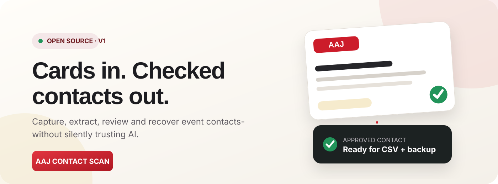
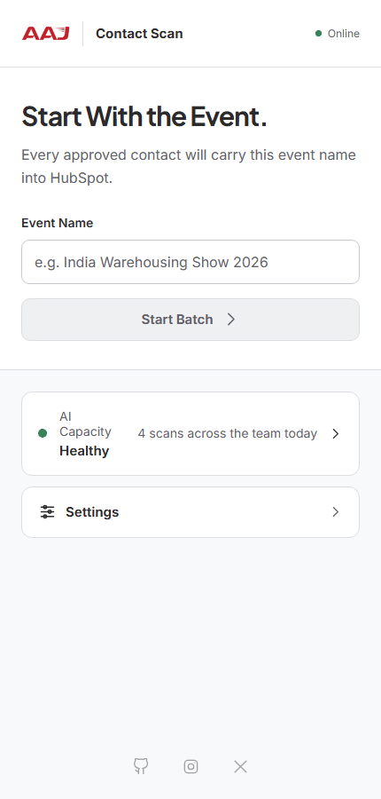
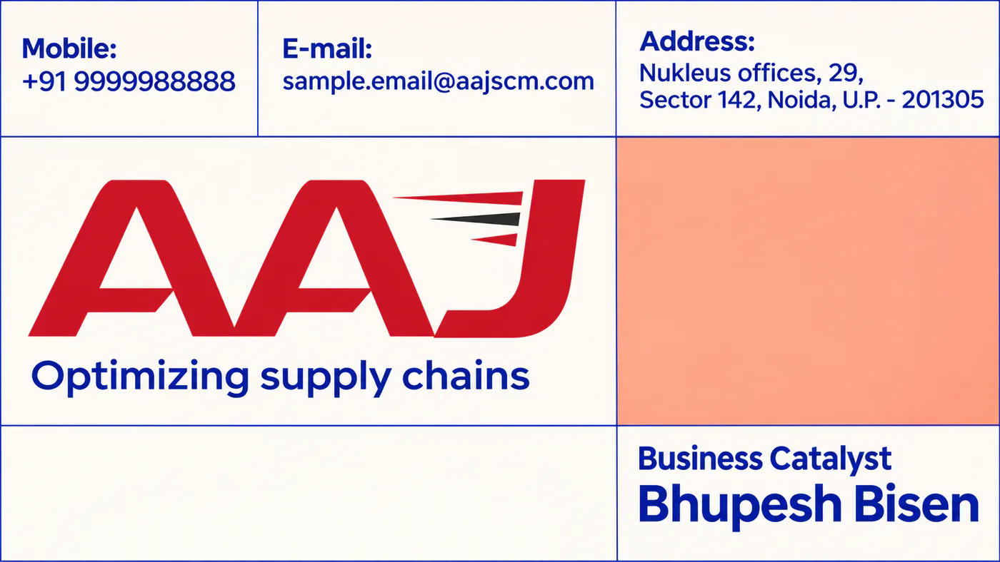
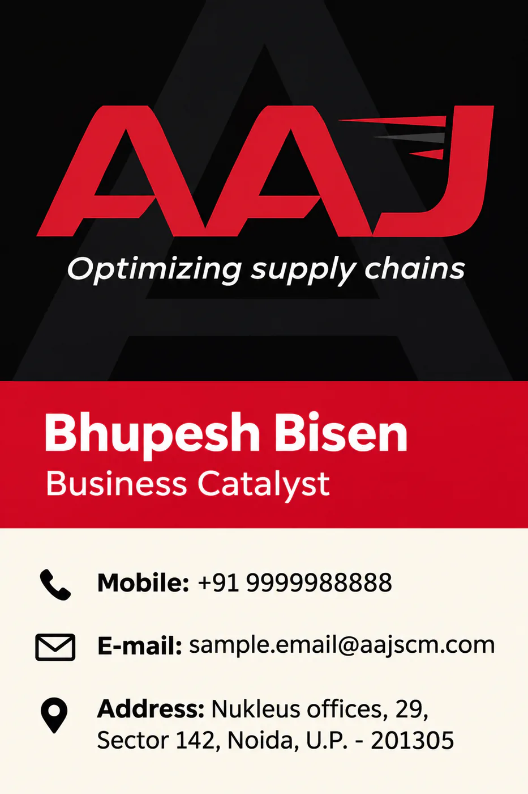
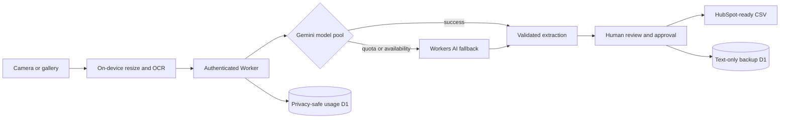

<div align="center">
  

  <p><strong>A privacy-aware, installable business-card scanner built for event teams.</strong></p>
  <p>Capture cards → extract with AI → review every field → share CSV → recover approved text.</p>

  <p>
    <a href="https://aaj.contact-scan.workers.dev/"><strong>Open the live app</strong></a>
    · <a href="#see-the-real-workflow">Watch the real workflow</a>
    · <a href="docs/DEPLOYMENT.md">Deploy your own</a>
  </p>
</div>

---

## From a stack of cards to a checked contact list

AAJ Contact Scan turns event business cards into a HubSpot-ready CSV without hiding uncertainty. It prepares images on-device, routes extraction through an adaptive Gemini model pool, falls back to Cloudflare Workers AI, and asks a human to approve every contact before export or backup.

| Capture | Review | Deliver |
|---|---|---|
| Camera or gallery, offline queue, local image preparation | Confidence states, editable fields, OCR grounding | Download/share CSV, text-only D1 backup, administrator recovery |

## See the real workflow

<p align="center">
  
</p>

<p align="center"><sub>Actual production interface · synthetic demonstration card · no real contact data</sub></p>

## What makes it useful

- **Human approval by design.** AI output never silently becomes a marketing contact.
- **Adaptive extraction.** Quota, rate-limit and temporary model failures rotate through configured Gemini models before Workers AI fallback.
- **Offline-friendly field work.** Batches and card photos remain on the phone until cleared.
- **Shared capacity visibility.** Privacy-safe usage events show team activity without storing card or contact data.
- **Recoverable approved text.** D1 stores approved contact fields only; photographs and raw OCR are never backed up.
- **Installable PWA.** The light-mode interface is designed for Android event teams and works from a normal URL.

## Try it safely

The repository includes twelve synthetic business cards with fictional/demo details. They can be used in screenshots, workshops and test deployments without publishing real event contacts.

<p align="center">
  
  
</p>

Browse the complete [`demo/synthetic-cards`](demo/synthetic-cards) set. These files are optimized WebP images with metadata removed.

## How it works



Card photos stay in browser storage until the batch is cleared. During an authorized scan, the prepared image is sent temporarily to the configured AI provider. Only approved text is eligible for backup. See [Security](docs/SECURITY.md) for the complete trust boundary.

## Run locally

Requires Node.js 24+.

```bash
git clone https://github.com/shashankshekharans/aaj-scan.git
cd aaj-scan
npm install
npm test
npm run dev
```

For a real deployment, do not reuse AAJ's Worker, D1 IDs, secrets or API quota. Follow [Deploy your own copy](docs/DEPLOYMENT.md) to create isolated resources.

## Project map

| Path | Responsibility |
|---|---|
| `src/` | React PWA, capture/review workflow, local storage, sharing and recovery UI |
| `worker/` | Authentication, Gemini routing, Workers AI fallback, usage and backup APIs |
| `core/` | Provider-neutral schema, extraction, grounding and scoring |
| `migrations/` | Independent D1 schemas for usage metadata and approved-contact backup |
| `eval/` | Provider evaluation harness; real cards and ground truth remain git-ignored |
| `demo/` | Public-safe synthetic card set |

## Documentation

- [Deployment](docs/DEPLOYMENT.md) - create your own Worker, D1 databases and secrets.
- [Operations](docs/OPERATIONS.md) - rotate credentials, recover CSVs, manage retention and respond to provider limits.
- [Security](docs/SECURITY.md) - public-repository boundary, data flow and vulnerability reporting.
- [Product requirements](docs/PRD.md) - original problem, scope and acceptance criteria.
- [Evaluation results](docs/EVALUATION_RESULTS.md) - provider comparison and accuracy safeguards.
- [Public repository model](docs/PUBLIC_TEMPLATE_PLAN.md) - how the AAJ showcase and reusable source coexist.

<details>
<summary><strong>Does a public repository expose the API keys or passcodes?</strong></summary>

No. Production secrets are stored as encrypted Cloudflare Worker secrets and are absent from Git. `.env` and `.dev.vars` are ignored. Public source code does expose the application's design, so strong unique credentials, edge rate limiting and regular rotation remain required.
</details>

<details>
<summary><strong>Does the repository contain real business cards?</strong></summary>

No. Real evaluation cards, ground truth and results are ignored. The committed cards are intentionally synthetic demonstration assets.
</details>

<details>
<summary><strong>Can another organization use this?</strong></summary>

Yes. Create your own Cloudflare databases and Worker secrets, then replace the deployment values and branding. Every deployment must be isolated; forks must never send data to AAJ's production Worker.
</details>

## Licence

Released under the [MIT Licence](LICENSE). The AAJ name and logo identify the reference deployment; adopters should replace them with branding they are authorized to use.
