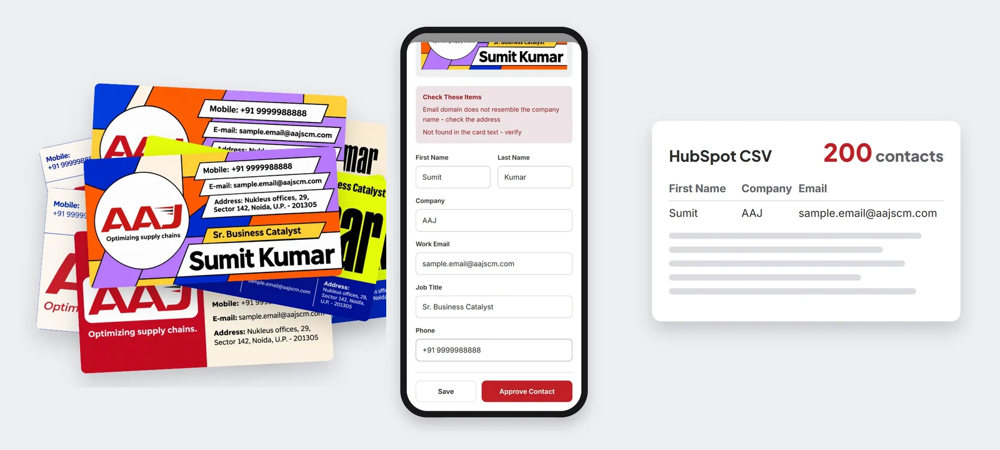
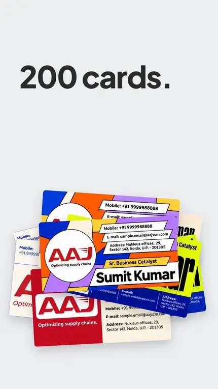
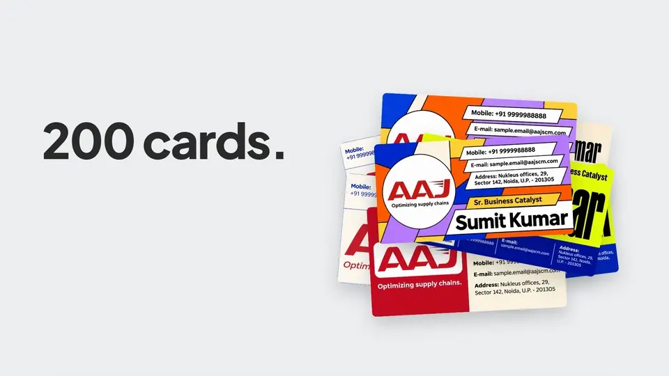
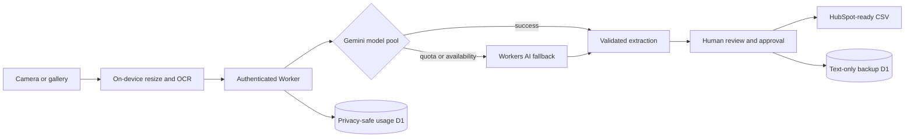

<div align="center">
  <picture>
    <source media="(prefers-color-scheme: dark)" srcset="docs/assets/aaj-scan-logo-dark.webp" />
    
  </picture>
  <br /><br />
  

  <h3>Every card from the event, in your CRM by Monday - checked, not guessed.</h3>

  <p>
    <a href="https://github.com/shashankshekharans/aaj-scan/actions/workflows/ci.yml"></a>
    <a href="https://github.com/shashankshekharans/aaj-scan/releases"></a>
    <a href="LICENSE"></a>
  </p>

  <p>
    <a href="https://aaj.contact-scan.workers.dev/"><strong>Open the live app</strong></a>
    · <a href="#see-it-work">See it work</a>
    · <a href="docs/FORKING.md">Use it for your team</a>
    · <a href="#about-aaj-scm">Built by AAJ SCM</a>
  </p>
</div>

---

## The Monday after the expo

The stall is packed away. What's left is a rubber-banded stack of business cards: two hundred conversations, each one a possible customer.

Then someone types them up. Name, title, company, email, phone, one card at a time, a couple of minutes each. By card eighty, a `0` becomes an `O`, an email loses a letter and a hot lead quietly bounces. The follow-up goes out days late, if it goes out at all.

AAJ's marketing team lived this after every trade show. So we built the tool we wanted.

## What AAJ Contact Scan does

**Point a phone at a card. Check what it read. Send the list to HubSpot.**

1. **Capture** the whole stack on an Android phone, one card at a time or as a fast batch, even with patchy venue Wi-Fi.
2. **Extract** each card with AI that reads the layout as well as the letters, then cross-checks every value against the text actually printed on the card.
3. **Review** a clean table. Cards the system is sure about are marked *looks good*; anything uncertain is flagged in plain language, never silently filled in.
4. **Deliver** a HubSpot-ready CSV in one tap, with every contact tagged to the event it came from.

## Built on one principle: never guess

AI that sounds confident is easy. AI that admits doubt is useful. Before choosing a model, we tested every candidate on 20 real, hard business cards: dark backgrounds, vertical layouts, stylised fonts, cards listing three people. The measure was **silent errors**, wrong answers that would slip into the CRM unflagged.

| Engine | Silent errors on 20 real cards | Role |
|---|---:|---|
| Google Gemini | **0** | Primary |
| Cloudflare Workers AI | **0** | Automatic fallback |
| Groq | 7 | Rejected for automatic approval |
| On-device OCR alone | 38 | Used only to cross-check the AI |

The method and full results are in [Evaluation results](docs/EVALUATION_RESULTS.md).

## See it work

### On the phone - capture, review, approve

<p align="center">
  
</p>

### On the desktop - the same flow, larger

<p align="center">
  
</p>

<p align="center"><sub>Real recordings of the app with a synthetic demonstration card. No real contact data is shown.</sub></p>

## Why teams trust it

- **A person approves every contact.** AI output never becomes a CRM record on its own.
- **Doubt is visible.** Missing fields, guessed companies, look-alike email domains and truncated titles are flagged where you'll see them.
- **Photos stay on the phone.** Card images are processed in the moment and stay in the browser until you clear the batch. They are never backed up.
- **Approved text is recoverable.** If an export is missed, an administrator can recover the event's approved contacts as a CSV.
- **It keeps working when quotas don't.** When one AI model hits its limit, the next takes over automatically.
- **Free to run at event scale.** Built on free tiers of Cloudflare and Google AI, with no per-card fees.

## How it works



The phone prepares each image and reads it locally first. A Cloudflare Worker authenticates the team, sends the prepared image to the AI provider and validates the answer against the local reading. Nothing reaches the CRM until a person approves it. The full trust boundary is described in [Security](docs/SECURITY.md).

## Use it for your own team

The code is MIT-licensed and designed to be forked. Every deployment gets its own Worker, databases and secrets, so your contacts never touch ours. Start with [Using AAJ Contact Scan for your organisation](docs/FORKING.md), then follow [Deployment](docs/DEPLOYMENT.md).

Twelve fictional business cards in [`demo/synthetic-cards`](demo/synthetic-cards) let you try the whole flow, record demos or run workshops without exposing anyone's details.

### Run locally

Requires Node.js 24 or later.

```bash
git clone https://github.com/shashankshekharans/aaj-scan.git
cd aaj-scan
npm install
npm test
npm run dev
```

## Project map

| Path | Responsibility |
|---|---|
| `src/` | React PWA: capture, review, local storage, sharing and recovery |
| `worker/` | Authentication, Gemini routing, Workers AI fallback, usage and backup APIs |
| `core/` | Provider-neutral schema, extraction rules, OCR grounding and scoring |
| `migrations/` | D1 schemas for usage metadata and approved-contact backup |
| `eval/` | Provider evaluation harness (real cards and ground truth stay private) |
| `brand/` | Source logos; `npm run brand:assets` regenerates optimised app assets |
| `demo/` | Public-safe synthetic business cards |

## Documentation

- [Using it for your organisation](docs/FORKING.md): what to replace and the isolation rule
- [Deployment](docs/DEPLOYMENT.md): create your own Worker, D1 databases and secrets
- [Operations](docs/OPERATIONS.md): rotate credentials, recover CSVs, manage retention
- [Security](docs/SECURITY.md): data flow, trust boundary and vulnerability reporting
- [Evaluation results](docs/EVALUATION_RESULTS.md): how the AI providers were chosen
- [Product requirements](docs/PRD.md): the original problem, scope and acceptance criteria
- [Changelog](CHANGELOG.md)

## About AAJ SCM

AAJ Contact Scan is built and run by **[AAJ Supply Chain Management](https://www.aajscm.com/)**, a full-stack supply chain partner for brands growing across India. Our marketing team meets prospects at trade shows and expos across the country. This tool is how those conversations reach our CRM while they're still warm.

We're sharing it because every team that collects business cards deserves better than retyping them.

<details>
<summary><strong>Does this public repository expose API keys or passcodes?</strong></summary>

No. Production secrets are encrypted Cloudflare Worker secrets and have never been committed. `.env` and `.dev.vars` are git-ignored. Because the source is public, deployments should still use strong, unique credentials and rotate them regularly.
</details>

<details>
<summary><strong>Does the repository contain real business cards?</strong></summary>

No. Real evaluation cards, ground truth and results are git-ignored. Every card in this repository is a synthetic demonstration asset.
</details>

<details>
<summary><strong>Can another organisation use this?</strong></summary>

Yes. Create your own Cloudflare resources and secrets, replace the branding and deploy. Forks must never send data to AAJ's production Worker.
</details>

## Licence

Code released under the [MIT Licence](LICENSE). The AAJ name and logo identify AAJ's reference deployment; please replace them with branding you are authorised to use.

---

<div align="center">

### Made by Shashank

<a href="https://github.com/shashankshekharans"></a>
<a href="https://www.instagram.com/shashankshekharans/"></a>
<a href="https://x.com/SHASHANK_ANS"></a>

<sub>Built for AAJ Supply Chain Management. Free tools only: GitHub, Cloudflare Workers, Google AI Studio and Cloudflare Workers AI free tiers.</sub>

</div>
